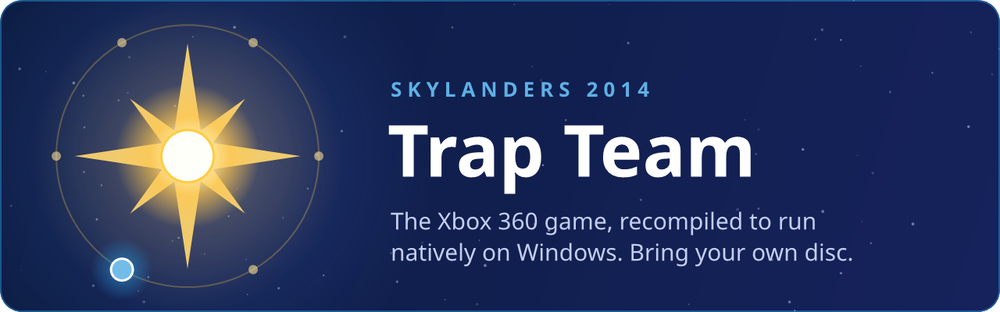
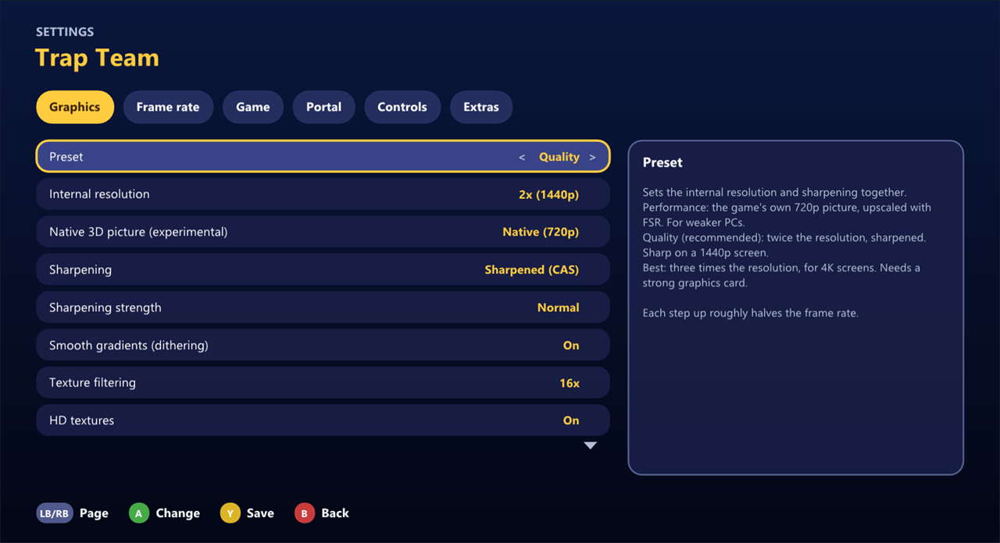

<a href="https://github.com/tsapZ/SkylandersCoreOfLight">Core of Light</a> (the launcher for all six) · <a href="#questions-people-ask">Questions</a> · <a href="#getting-started">Getting started</a> · <a href="#which-disc">Which disc</a> · <a href="#help">Help</a> · <a href="https://github.com/tsapZ/TrapTeamRecomp/issues/new/choose">Report a problem</a>

 

**Skylanders: Trap Team** (Xbox 360, 2014) as a native Windows game: your real portal and figures or none at all, a controller, up to 3x the
console's resolution, 60 FPS, traps and villains, no emulator. You bring your own copy of the game;
nothing of it comes with this project.

> Unofficial fan project. Not affiliated with or endorsed by Activision or Toys for Bob.

## Questions people ask

**Can I use my real portal and figures?** Yes. Plug it in: the game finds it by itself (F4 > Portal is *Automatic*), reads your figures and saves their progress on them, as on the console, and the portal menu still has the figures you don't own. Every figure you put on gets a backup file. *Real USB portal only* leaves the menu out. The PS3, Wii and PC portals work as they are, also with the WinUSB driver a Dolphin or Cemu setup gives them; an Xbox 360 portal needs WinUSB (Zadig), as for Xenia. For traps you need a Traptanium portal (the Xbox 360 one was tested by a player). If yours doesn't work, F4 > Game > *Report a problem*: its log says what the game saw.

**Can I play without figures?** Yes: without a real portal, a menu with every figure opens when the game asks for a Skylander. Their progress is kept in files in `Documents\Skylanders\Figures`, and one button swaps back to the Skylander you played before.

**Can I play with a friend?** Yes, two players on one PC, as on the console: the second player opens the portal menu on their controller (Guide, or Back + Start) and puts their Skylander on. L3 + R3 sorts out which controller plays which player. Online play isn't there yet.

**How do traps and villains work without the toys?** Through the portal menu too: when the game wants a trap, the menu opens on the right element, and the villain vault and swapping villains in work as on the console.

**Which game do I need? Does my Wii or PS3 copy work?** Your own copy of Trap Team on Xbox 360: for now the European Xbox 360 disc ([which one exactly](#which-disc)), as an ISO or an extracted folder. The setup takes the game's data from it; nothing of the game comes with this. Wii, PS3 and other versions are different programs and don't work.

**Is this an emulator?** No. The game's code is recompiled into a Windows program, so it runs natively: higher resolutions, 60 FPS and more, a settings menu, the portal menu. Emulators like Dolphin or Xenia run the original game instead; both are fine ways to play.

**Does it run on Linux, Steam Deck, Mac or Android handhelds?** It's made for Windows (64-bit) and tested there. Wine / Proton may work but isn't tested much; Mac, Android and ARM handhelds aren't supported.

**Is it safe?** All of the source is here on GitHub. The setup isn't signed, so Windows may warn before it runs ([what to click](#getting-started)).

**Was AI used?** Yes, almost all of the code was written with Claude; see [How it was made](#how-it-was-made).

## Getting started

**The easy way:** install [Core of Light](https://github.com/tsapZ/SkylandersCoreOfLight/releases)
and show it your disc. It downloads this game, sets it up and keeps it up to date, and does the same
for the other five games.

**On its own:**

1. Download `TrapTeamRecompSetup-<version>.exe` from the [Releases](https://github.com/tsapZ/TrapTeamRecomp/releases) page.
2. Run it and pick your disc, as an ISO file or an extracted folder. It checks the version and takes
   what it needs.
3. Start the game from the desktop or the Start menu.

What you need:

- Windows 10 or 11 (64-bit) and a graphics card with DirectX 12
- your own Xbox 360 disc of the game ([which one](#which-disc))
- a controller (Xbox or compatible); keyboard and mouse work too. A real Portal of Power is optional.

Tested on a Ryzen 5 5600 with a Radeon RX 6800 XT (32 GB RAM, Windows 11): a steady 60 FPS at 2x (1440p). Without the frame cap the hub runs at about 87 FPS at 2x, with the native 3D picture on.

The setup isn't signed, so Windows may say "Windows protected your PC": click **More info**, then
**Run anyway**. No admin rights needed.

 

## What you get

- **A sharper picture:** 1x, 2x or 3x the console's 720p, the 3D scene drawn at the full 720p instead
  of the console's smaller size, sharpening (AMD CAS, or FSR 1 when the window is bigger) and 16x
  texture filtering, with the presets *Performance*, *Quality*, *Best* and *As on the console*.
  Bloom and motion blur can be turned down.
- **60 FPS**, or 30 as on the console, or 144 and more. The game keeps its normal speed.
- **Ultrawide:** a wider window shows more to the sides, and the HUD moves out to the edges.
- **No portal needed:** when the game asks for a Skylander, a menu with every figure opens by itself,
  in the game's own look. A real USB portal works too, or both at once.
- **Traps without the trap slot:** when the game wants a trap, the menu opens on the right element.
  A caught villain talks from your PC's speakers, as from the Traptanium portal.
- **Your figures keep their progress** (level, gold, hats, upgrades) in files you can back up, and
  each one is backed up before the game first saves over it: the portal menu puts an older version back.
- **Quick swap:** one button puts the Skylander you played before back on the portal.
- **Skip any movie:** Start ends the movie that is playing (F4 > Game: off, or A instead).
- **A settings menu** in the game: graphics, frame rate, language, portal, controls, and *Extras*
  (no health loss, full gold, always crit, elemental power everywhere, gold and XP multipliers; off by
  default, and *Show cheats* hides the lot).
- **Achievements.**
- **A Discord status:** the game, your Skylander and the level, while the Discord app runs. F4 > Game turns it off.
- **HD texture packs** work too ([how](https://github.com/tsapZ/SwapForceRecomp/blob/main/docs/texture-packs.md)).
- **Languages:** English and German; French, Spanish and Italian as well.

Its settings in Core of Light, the same pages as in the game's own menu (F4). The game's own pictures aren't shown here: they're Activision's.

 

## Controls

The game plays as it always did. On top of that:

| | Controller | Keyboard |
|---|---|---|
| Portal menu (put figures and traps on) | Guide, or Back + Start | F6 |
| Take figures off | Back + Y | F5 |
| Settings | Back + RB | F4 |
| Achievements | in the settings, under Game | F7 |
| Which controller plays which player | L3 + R3 | F9 |

The settings menu shows the keyboard keys for the game itself under Controls.

 

## How far it is

Chapter 1 and the Skylanders Academy play, with traps, the villain vault and swapping villains in,
and in automated test runs all 26 story levels load without a crash. Nobody has played the whole
game to the end yet. If something breaks further in, please [tell
me](https://github.com/tsapZ/TrapTeamRecomp/issues/new/choose).
What's being worked on: [docs/roadmap.md](docs/roadmap.md). Known bugs and the details:
[docs/STATUS.md](docs/STATUS.md).

 

## Help

**The setup says it's the wrong disc.** This port is made for one version of the game (see
[Which disc](#which-disc)). If you have another one, open an issue with the message (it names the disc's title, region and hash).

**It runs slowly.** Press F4, go to Graphics and pick *Performance*, or a lower internal resolution.

**Voices are missing with headphones.** If Windows has your sound output set up as 5.1 or 7.1, the game sends surround sound, and voices on the center channel (in Spyro's Adventure all of the movies' voices) don't reach headphones. F4 > Game > *Sound output: Stereo* mixes everything down to two channels; so does setting the output to Stereo in Windows' sound settings.

**Where are my saves and figures?** Saves in `Documents\Skylanders\Trap Team`, figures in
`Documents\Skylanders\Figures` (shared by all six games). Core of Light can export all of it for a
new PC.

**Why are there no screenshots of the game?** They'd show its artwork, which belongs to Activision. The picture above is its settings page in Core of Light, the banner our own drawing.

## Which disc

The European Xbox 360 disc (PAL, title `41560911`). Its SHA-256 is in
[docs/game/default.xex.sha256](docs/game/default.xex.sha256); the setup, the game and the launcher
check it. Another pressing with the same code (another language set, for example) works as well: they also compare the code part of the file ([docs/game/default.xex.code](docs/game/default.xex.code)). Other regions usually have other code and don't work yet.

## Reporting a problem

Open an [issue](https://github.com/tsapZ/TrapTeamRecomp/issues/new/choose) with the **Problem** form:
what you did and what happened. It helps a lot to attach the report from Core of Light (**LB**, the
launcher's settings, > **Report a problem**, or the question it asks after a crash). That's one text
file on your desktop with the latest logs and settings, your Windows user name taken out. Without
the launcher, the logs are in the `logs` folder next to the game's exe.

 

## Why this exists

I wanted to play the Xbox 360 Skylanders games on my PC with just a controller, no emulator, and
with a nicer picture. That's really all it is: a private fan project. It's public in case someone
else wants the same.

## How it was made

To be upfront about it: almost all of the code here was written by [Claude](https://claude.ai) in
Claude Code, the recompile setup, the fixes, the portal menu, the launcher and the installer, and
most of the docs too. I decided what to build, said what was broken and played the games a lot. If
AI-made projects aren't your thing, that's fair.

 

## For developers

The game's Xbox 360 code is recompiled to x86-64 with [ReXGlue](https://github.com/rexglue/rexglue-sdk)
(no CPU emulation); the graphics go through Xenia's D3D12 path. This repository holds only our own
code: the recompiled game code is made on your PC from your disc's `default.xex` when you build.

Building needs Windows, Visual Studio 2022 (C++ workload and C++ Clang tools), CMake, Ninja, just,
Git and Python 3, and the extracted disc in `rom/` ([rom/README.md](rom/README.md)). Steps:
[docs/development.md](docs/development.md), then `just play-release`. `just package-installer` builds
the setup. All docs: [docs/README.md](docs/README.md).

The banner and the button at the top are drawn by Core of Light's [`tools/make_banner.ps1`](https://github.com/tsapZ/SkylandersCoreOfLight/blob/main/tools/make_banner.ps1).

## Credits

- **[GiantsRecomp](https://github.com/tsapZ/GiantsRecomp)**, **[SSARecomp](https://github.com/tsapZ/SSARecomp)**
  and **[SwapForceRecomp](https://github.com/tsapZ/SwapForceRecomp)**: this project is scaffolded
  from them; app, portal, menus and tooling come from there.
- **[GiantsRecomp by TheBiemGamer](https://github.com/TheBiemGamer/GiantsRecomp)** brought
  Skylanders Giants to PC first and is the template these ports started from.
- **[ReXGlue](https://github.com/rexglue/rexglue-sdk)**, the static recompilation SDK, here in a
  fork with our fixes on top.
- **[skylanders-portal](https://github.com/TheBiemGamer/skylanders-portal)** by TheBiemGamer:
  the portal (software and USB), its overlay and the figure catalog, here in a fork with the
  shared portal and settings menus on top.
- Figure save-data decoding builds on public reverse-engineering of the Skylanders NFC format,
  among others **[SkyReader](https://github.com/reedstrm/SkyReader)**.
- **[extract-xiso](https://github.com/XboxDev/extract-xiso)** is included (prebuilt, unmodified)
  for the installer (`installer/extract-xiso.LICENSE.txt`).

Skylanders is a trademark of Activision. This project is not affiliated with or endorsed by
Activision.

## License

The code and documentation in this repository are released under the [MIT license](LICENSE). That
doesn't cover the game or its data, which you need to own and supply yourself, or the third-party
components in `thirdparty/`, which keep their own licenses.
